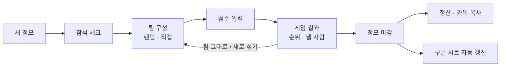

# 🎳 떼굴 · 볼링 동호회 기록 서비스

> 정모 현장에서 운영진이 휴대폰으로 **팀을 나누고 점수만 입력하면**, 핸디·승패·내기 정산·에버리지·티어 근거가 자동으로 계산되는 웹앱.
> 회원은 로그인 없이 링크로 들어와 자기 점수, 낼 금액, 승률, 상대 전적을 확인합니다.
>
> 🔗 서비스: https://bowling-recorder.vercel.app · `main`에 푸시하면 Vercel이 자동으로 배포합니다.

---

## 1. 문제 정의

볼링 동호회를 운영하며 매 정모마다 반복되던 불편 네 가지에서 시작했습니다.

| # | 문제 | 왜 문제였나 |
|---|---|---|
| 1 | **점수 수기 기록** | 정모가 끝나면 운영진이 스프레드시트에서 참석자를 한 명씩 찾아 게임별 점수를 손으로 옮겨 적었다. 실수가 잦고 시간이 오래 걸렸다. |
| 2 | **티어 기준이 불명확** | 에버리지로 티어를 나누지만 "최근에 확 늘었다", "누구는 누구를 못 이긴다" 같은 **운영진의 암묵지**가 크게 작용했다. 근거가 남지 않아 결정이 설명되지 않았다. |
| 3 | **내기 정산이 번거로움** | 매 게임 팀전으로 게임비 내기를 하는데, 누가 몇 판 졌고 누구 몫까지 내야 하는지 계산이 복잡했다. 팀이 셋이거나 인원이 다르면 더 복잡해졌다. |
| 4 | **팀 배분과 핸디 계산** | 에버가 비슷한 사람끼리 가위바위보로 팀을 나누고, 핸디표를 보고 팀별 핸디를 손으로 합산했다. |

## 2. 솔루션

| 문제 | 해결 |
|---|---|
| 1. 수기 기록 | 참석 체크 → 팀 구성 → **휴대폰으로 점수 입력**(3자리 치면 다음 사람으로 자동 이동, 입력 즉시 저장). 정모를 마감하면 **구글 시트로 자동 내보내기**. |
| 2. 티어 기준 | 티어를 자동으로 바꾸지 않습니다. 대신 **전체 에버·최근 20게임 폼·상대 전적**을 한 화면에 보여주고 승급/강등 **후보**만 표시합니다. 운영진이 바꿀 때는 **사유를 반드시 기록**합니다. 암묵지가 데이터로 남습니다. |
| 3. 내기 정산 | 점수가 들어오면 순위와 **사람별 낼 금액**이 바로 계산되고, 카톡에 붙여넣을 정산 텍스트를 한 번에 복사합니다. |
| 4. 팀 배분 | 에버 순으로 묶어 팀별로 한 명씩 **랜덤 배정**(가위바위보 자동화) 또는 직접 구성. 상대방 티어 차이로 **핸디 자동 계산**. 합의로 조정할 수 있습니다. |

### 정모 하루 흐름



## 3. 핵심 규칙

동호회에서 실제로 쓰던 규칙을 코드로 옮겼습니다. 계산은 모두 `lib/domain/`의 순수 함수이고 단위 테스트가 붙어 있습니다.

- **팀 배분**: 참석자를 에버 순으로 세워 팀 수만큼씩 묶고, 각 묶음에서 팀마다 한 명씩 랜덤 배정합니다. **같은 묶음 사람들이 그 게임의 "상대방"**입니다. 팀 간 인원 차이는 최대 1명입니다.
- **핸디**: 상대방끼리 티어별 핸디표 값을 비교해 **낮은 티어가 그 차이만큼** 받습니다. (예: 4티어 20 vs 5티어 26 → 5티어 +6)
- **꼭두각시**: 인원이 1명 적은 팀에는 "꼭두각시"가 들어가고, 상대가 없던 사람의 에버가 꼭두각시 점수입니다.
- **팀이 받는 핸디**: 팀별 (팀원 핸디 + 꼭두각시)를 비교해 가장 적은 팀을 0으로 두고 **차이만** 받습니다. 화면에는 받는 팀에만 표시합니다.
- **순위·동점**: 팀 점수 = 점수 합 + 받는 핸디. 동점이면 **핸디를 받은 팀이 집니다.**
- **정산**: 1등↔꼴찌, 2등↔뒤에서 2등으로 짝을 지어 아래 팀이 위 팀 게임비까지 냅니다. 짝이 없는 가운데 팀은 자기 몫만 냅니다. 이긴 팀 인원이 더 많으면 그 팀의 개인 꼴찌(점수+핸디)가 자기 몫을 내고, 진 팀 인원이 더 많으면 진 팀의 개인 최고점자(점수+핸디)는 자기 몫만 냅니다. 1/N 금액은 100원 단위로 올립니다.
- **승률**: 팀이 1등이면 승. **상대 전적**: 그 게임의 상대방과 점수+받은 핸디로 비교합니다.
- **티어 후보**: 티어별 기준 에버(10게임 이상 활동 회원의 중앙값) 사이의 중간값을 최근 20게임 에버가 넘으면 승급, 밑돌면 강등 후보로 표시합니다.

## 4. 결정 사항과 이유

| 결정 | 이유 |
|---|---|
| **스프레드시트를 버리지 않고 "DB + 시트 자동 내보내기"** | 시트를 직접 DB로 쓰면 느리고 구조가 바뀌면 깨집니다. 데이터는 DB에 두고, 운영진이 익숙한 시트는 마감 때마다 기존 엑셀과 같은 모양의 `점수기록지` 탭(한 사람 한 줄, 점수를 가로로)으로 덮어씁니다. |
| **티어는 자동으로 바꾸지 않고 "근거 + 후보 + 사유 기록"** | 티어에는 점수 말고도 운영진 판단이 들어갑니다. 기계가 정하면 신뢰를 잃고, 사람이 정하면 근거가 사라집니다. 둘 다 피하려고 근거는 시스템이, 결정은 사람이 하고, 그 이유를 이력으로 남겼습니다. |
| **후보 기준은 "티어 기준 중앙값의 중간"** | "위 티어 최저 / 아래 티어 최고 에버" 기준도 시도했습니다. 그런데 실제 데이터에서 2·3티어 범위가 겹쳐 서로가 서로를 후보로 만드는 문제가 있어 되돌렸습니다. 중앙값은 극단값 한두 명에 덜 흔들립니다. |
| **랜덤 배정 = 가위바위보 자동화** | 완전 랜덤이면 실력 차가 커집니다. 기존 관행(비슷한 사람끼리 가위바위보)을 그대로 옮겨, 묶음이 곧 "상대방"이 되도록 했습니다. 직접 구성 모드도 둡니다. |
| **핸디는 상대방 간 차이, 팀은 순 핸디만** | 동호회 실제 규칙입니다. 팀원 핸디를 그냥 더하면 숫자가 커져 헷갈리므로, 받는 팀에 차이만 보여줍니다. |
| **핸디는 "합의 조정" 허용 + 기본값 함께 저장** | 현장에서는 상황에 따라 합의로 핸디를 바꿉니다. 막지 않되 원래 값을 남겨 나중에 왜 숫자가 다른지 알 수 있게 했습니다. |
| **티어·핸디는 게임 확정 시점 값으로 스냅샷** | 나중에 티어나 핸디표가 바뀌어도 과거 게임의 결과와 정산이 바뀌면 안 됩니다. |
| **에버·순위·정산은 저장하지 않고 점수에서 매번 계산** | 점수 하나를 고치면 관련 숫자가 모두 자동으로 맞춰집니다. 불일치가 생길 여지를 없앴습니다. |
| **운영진은 공용 비밀번호, 회원은 로그인 없음** | 운영진 2~3명, 회원 40여 명인 동호회에 개인 계정은 과합니다. 회원은 단톡 링크로 들어와 이름만 고르면 됩니다(기기별 쿠키). 쓰기 권한은 운영진 세션에만 있고 서버에서 매번 확인합니다. |
| **모바일 우선, 입력은 차분하게 / 결과는 전광판처럼** | 실제 사용 장소는 볼링장 레인 앞입니다. 입력 화면은 큰 숫자 칸과 단계형 흐름(실수 방지), 결과 화면은 다 같이 들여다보는 전광판 스타일로 나눴습니다. |
| **DB는 브라우저에서 접근 불가 (RLS 전부 차단)** | 모든 읽기·쓰기는 서버에서 비밀 키로만 합니다. 공개 링크로 회원 화면을 열어도 DB에는 직접 닿지 않습니다. |
| **엑셀 기록은 에버리지에만 사용** | 기존 엑셀에는 날짜와 팀 정보가 없습니다. 그래서 564게임은 에버·최근 폼 계산에만 쓰고, 승률·상대 전적은 앱에서 기록한 게임부터 쌓습니다. |
| **구글 연동은 `googleapis` 없이 직접 호출** | 이미 쓰는 `jose`로 서비스 계정 토큰을 만들어 Sheets REST API를 부릅니다. 무거운 의존성을 줄였습니다. |
| **1/N 금액은 100원 단위 올림** | 현금·송금 모두 100원 미만은 번거롭습니다. 차액은 정산 화면에 따로 표시합니다. |

## 5. 화면

첫 화면(`/`)에서 **회원** / **운영진**으로 나눠 들어갑니다.

| 운영진 (`/admin`) | 회원 (`/home`, 로그인 없음) |
|---|---|
| 홈: 새 정모 만들기, 진행 중 정모, 메뉴 | 홈: 처음엔 이름 고르기 → 최근 정모의 내 점수·승패·**낼 금액**, 결과·내 기록·랭킹 메뉴 |
| 정모: 참석 체크 → 팀 구성 → 점수 입력 → 결과 → 마감·정산, 정모 삭제 | 결과: 정모별 전광판, 전체 점수표, 정산 |
| 회원: 목록(승급·강등 후보 배지), 상세(근거·상대 전적·티어 변경 + 사유) | 내 기록: 에버·최근 폼·승률·상대 전적·전체 게임 기록·엑셀 이전 기록 |
| 설정: 핸디표, 기본 게임비, 최근 N게임, 구글 시트 | 랭킹: 전체 에버 / 최근 폼 / 승률 |

화면 설계 시안은 [`mockups/index.html`](mockups/index.html), 기획 문서는 [`docs/`](docs/)에 있습니다.

## 6. 기술 구조

- **Next.js 16 (App Router) + TypeScript + Tailwind CSS 4**: 서버 컴포넌트와 서버 액션
- **Supabase (Postgres)**: 데이터 저장, 마이그레이션은 `supabase/migrations/`
- **Vitest**: 도메인 규칙 단위 테스트
- **Vercel**: 배포

```
app/(public)/       회원 화면 (홈 · 결과 · 내 기록 · 랭킹)
app/admin/          운영진 화면 (로그인, 정모, 회원, 설정)
components/         공용 UI (하단 탭, 전광판, 회원 기록)
lib/domain/         순수 계산 규칙 + 테스트 (팀 배분, 핸디, 순위, 정산, 통계, 티어)
lib/db/             Supabase 조회
lib/sheets/         구글 시트 내보내기
scripts/            기존 엑셀 가져오기
supabase/           DB 마이그레이션
docs/               요구사항 · 흐름/디자인 · 구현 계획
```

## 7. 시작하기

```bash
npm install
cp .env.example .env.local   # 값 채우기 (아래 표)
npm run dev                  # http://localhost:3000
npm test                     # 도메인 규칙 테스트
```

| 환경 변수 | 설명 |
|---|---|
| `NEXT_PUBLIC_SUPABASE_URL` | Supabase 프로젝트 URL |
| `SUPABASE_SECRET_KEY` | Supabase secret 키 (서버 전용) |
| `ADMIN_PASSWORD` | 운영진 공용 비밀번호 |
| `SESSION_SECRET` | 세션 쿠키 서명 키 (32자 이상 임의 문자열) |
| `GOOGLE_SERVICE_ACCOUNT_EMAIL`, `GOOGLE_PRIVATE_KEY` | (선택) 구글 시트 내보내기용 서비스 계정 |

1. Supabase 프로젝트에 `supabase/migrations/`의 SQL을 순서대로 적용합니다.
2. (선택) 기존 엑셀 기록 가져오기: `node --env-file=.env.local scripts/import-xlsx.mjs "기록.xlsx"`
   - `티어표` 시트(이름·티어)와 `점수입력` 시트(이름·점수)를 읽습니다.
3. (선택) 구글 시트: 서비스 계정 이메일에 시트를 "편집자"로 공유한 뒤, 운영진 설정에 시트 주소를 넣습니다.
